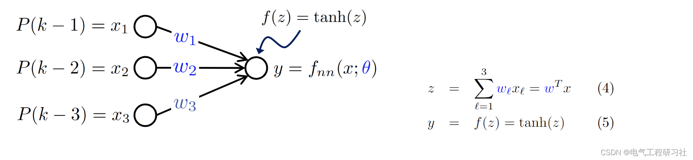
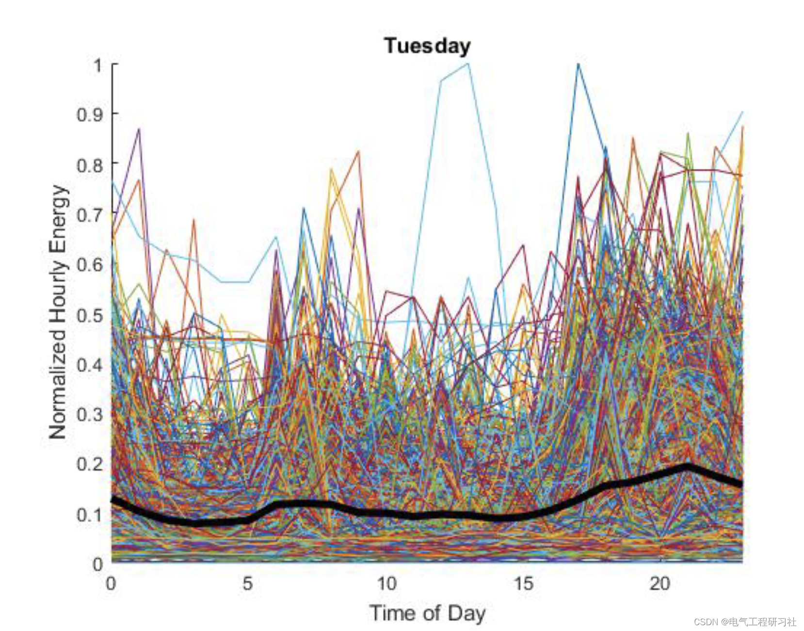
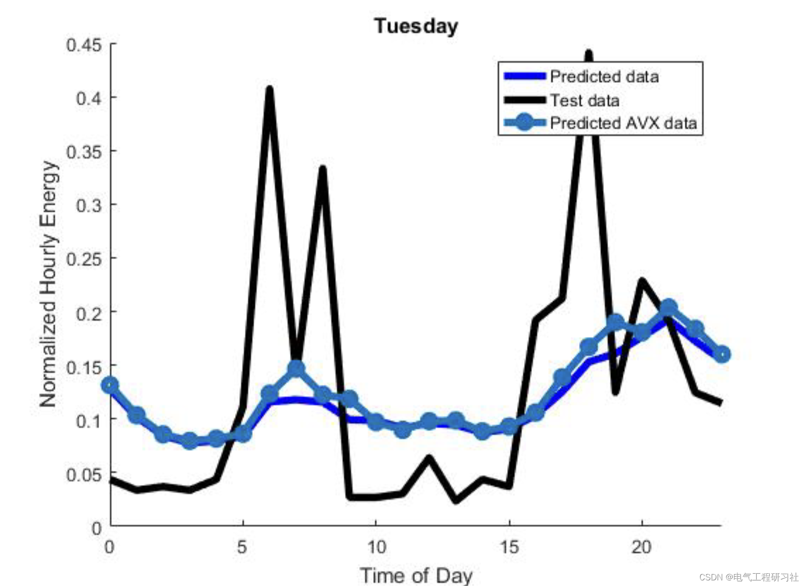
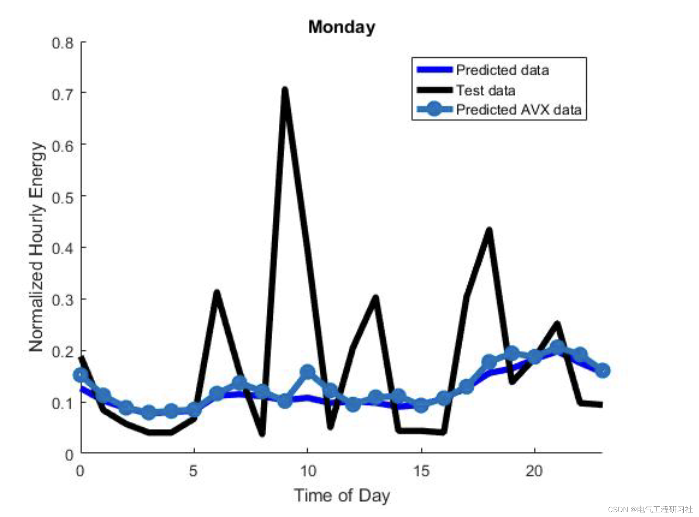
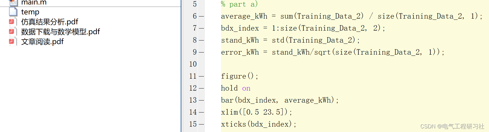

# Demand Side Electricity Load Forecasting (Matlab Code Implementation)

​  
1. Overview: The demand forecasting for building electricity is bound to play a significant role in future power grids. Given the deployment of intermittent renewable energy sources and the increasing electricity consumption, generating accurate building-level power demand forecasts will be valuable for grid operators and building energy management systems. The literature contains a wealth of individual building prediction models. However, a persistent challenge is the development of a broadly applicable method for demand forecasting across geographic locations, seasons and usage types. This paper addresses the need for a universal method for power demand forecasting, which employs an integrated learning approach to perform real-time model validation and selection through the use of gating functions. By learning from the data stream of power demand, this method is almost independent of the final use of energy and thus is well-suited for real-world deployment. Although ensemble methods can combine complex predictors, such as artificial neural networks or seasonal autoregressive integrated moving average models, this work will focus on using simpler models, such as ordinary least squares and k-nearest neighbors. By applying our method to 32 building power demand datasets (8 commercial and 24 residential), we generated average absolute percentage error of 7.5% and 55.8% for commercial and residential buildings, respectively. Improving the accuracy of power demand forecasting is beneficial for the management of power systems, and recently, there has been a focus on using various models for short-term building-level power demand forecasting [4][5]. The ability to accurately and adaptively predict demand-side load will play a key role in maintaining grid stability and achieving the integration of renewable energy. Furthermore, under the framework of demand response and microgrid management, many novel optimal control schemes require short-term building electricity demand forecasting to aid decision-making.
2 Mathematical Models
Editor
For detailed mathematical models, refer to Part 4.
3. Running results Here, we present the results of two days' operation, and for the remaining five days, we will not display them one by one.
Editor
Editor
Editor
Editor
4. Matlab code and detailed explanation - this article only showcases a portion of the code, all codes can be found in:
Editor

## Images

<!-- PAYMENT_BLOCK -->

## Get this dataset

- Payment link (Stripe): [Buy now](https://buy.stripe.com/3cs8yP7sY87d0vu9AB)
- Payment QR code: 

<!-- /PAYMENT_BLOCK -->
